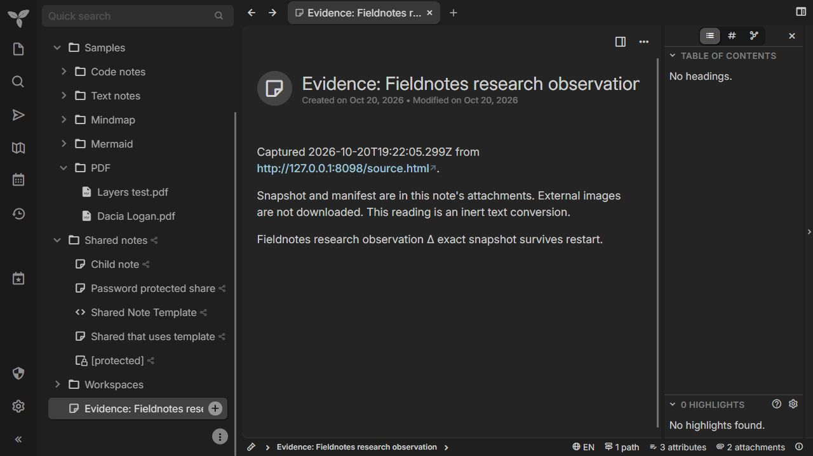
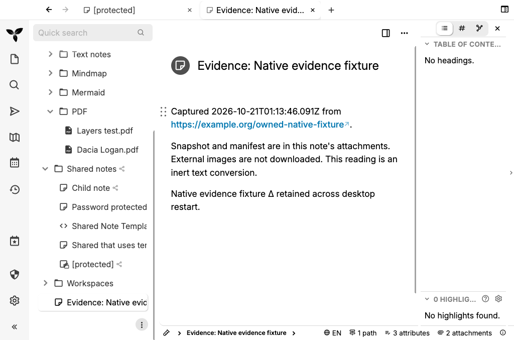

# Fieldnotes

Evidence capture for a local research notebook. A full [Trilium](https://github.com/TriliumNext/Trilium) fork with a browser clipper, web application, SQLite service, and Electron desktop source.

Fieldnotes adds separate capture records, exact UTF-8 snapshot attachments, versioned manifests, SHA-256 consistency checks, and repeat-safe receipt handling. A researcher can keep an editable reading note while retaining the captured representation beside it.



Synthetic capture opened in the real web application after a server restart. The reading note is editable; its exact snapshot and manifest are separate attachments.

## What this fork adds

- Article and selection evidence previews with source, destination, timestamp and digest.
- Confirmation bound to the captured bytes, browser tab, document identity and destination.
- A separate record for each capture. An identical retry returns its original receipt; a changed retry returns a conflict.
- A snapshot stored as an inert text attachment, a JSON manifest, and a readable text conversion. The server does not download missing images.
- A broker that rejects privileged requests from content scripts. Notification links use expiring, one-use grants scoped to a tab, top frame, URL and saved action.
- Redacted connection status, Chrome trusted-context storage access and a reusable real-server verification driver.

Trilium supplies the editor, note hierarchy, search, SQLite storage, sync, desktop shell, existing capture modes, and most of this repository. The original [README](README.upstream.md) and license notices are preserved. Fieldnotes starts from upstream commit [`8a6ba90`](https://github.com/TriliumNext/Trilium/commit/8a6ba90e6c9456b3f5552be0122a4972c5c6818b).

## Run an isolated demo

Use Node **24.22.0** and pnpm **12.14.0**.

```sh
pnpm install --frozen-lockfile
node tools/verify-fieldnotes-server.mjs demo-001 8097
```

The driver copies the checked-in synthetic fixture into a new, ignored run directory. It starts the real application on `http://127.0.0.1:8097` and an owned source fixture on port 8098. Open the application and use the fixture's existing password, `demo1234`. This public test password is for a loopback demonstration only.

Enter commands in the driver's terminal:

```text
evidence
restart
verify
cleanup
```

`evidence` preserves a synthetic research observation through the production HTTP route. `restart` reopens the same SQLite database and checks exact bytes, manifest hashes and the original receipt. `cleanup` stops the owned processes while retaining evidence under `.audit/verification/demo-001/`.

Use a new run name each time. For a new personal notebook, follow [Trilium's setup guide](README.upstream.md) with your own data directory and credentials.

## Build the clipper

```sh
pnpm --filter web-clipper build
pnpm --filter web-clipper build:firefox
```

Chrome output is `apps/web-clipper/.output/chrome-mv3`; Firefox output is `.output/firefox-mv2`. Configure the built extension against this fork's server, then use **Preview article evidence** or **Preview selection evidence** in the popup. Inspect the destination and digest before **Preserve this capture**. The ordinary Trilium store extension does not contain Fieldnotes' additions.

Evidence capture requires browser document IDs. A browser without that capability can still use inherited capture modes, but the new evidence action refuses to proceed. Both targets build locally; neither target has an installed-extension acceptance pass yet.

## Verification

```sh
pnpm --filter web-clipper test --run --coverage
pnpm --filter server test --run src/routes/api/evidence.spec.ts src/routes/api/clipper.spec.ts
pnpm typecheck
```

The clipper has 176 passing tests with its existing 100% line, statement, branch and function thresholds. The real HTTP driver verifies authentication, capture receipts, byte preservation, server restart and zero server requests for missing images. [Verification instructions and feature map](.agents/skills/verify-fieldnotes/SKILL.md) distinguish those checks from native desktop and installed-extension evidence.

The Windows desktop bundle builds, and the actual Electron 44.7.2 main process preserves an evidence record, passes Host-header checks and retains that record in SQLite after shutdown. Its maintained driver is `node tools/verify-fieldnotes-desktop.mjs <new-run-name> 8099`.

The [hosted native check](https://github.com/STEVVVU/fieldnotes/actions/runs/39525816828) also passed on macOS. It captured evidence through the real Electron process, displayed it over the production custom protocol, closed the app, reopened the same SQLite profile and checked the exact retained record and original-ID retry. The actual reopened PNG was inspected. Sandbox protections, disabled Node integration and context isolation remained in place; the owned process group and listener stopped, with evidence retained. This establishes the tested Mac renderer and restart path, not Windows rendering or packaged installation.



Actual hosted Mac renderer after restart, showing a synthetic capture. The reading note is an inert text conversion; the snapshot and manifest remain separate attachments.

## Research connection

The broker experiment adapts the compromised-content-script threat model from [Carlini, Felt and Wagner, *An Evaluation of the Google Chrome Extension Security Architecture*, section 5.1](https://www.usenix.org/system/files/conference/usenixsecurity12/sec12-final177_0.pdf). Regression cases attempt unsolicited saves, arbitrary PDF fetches, unrelated tab closure and arbitrary note opening, then check that denied requests have no network or tab side effects.

[MIT 6.858's Browser Security lab](https://www.css.csail.mit.edu/6.858/2022/labs/lab4.html) is a related course exercise for browser isolation and defensive evaluation. This fork applies that learning direction to a complete notes application. It does not claim completion of the course lab or reproduction of the paper's full study.

## Limits

Hashes establish consistency of the stored bytes. They do not prove website authorship or provide a trusted timestamp. A database owner can edit attachments and integrity labels. Capture routes do not overwrite an existing record, but this application is not write-once storage or a forensic chain-of-custody system.

The snapshot is extracted HTML, not a complete original HTTP response or an offline page archive. The manifest lists referenced images as not captured. The server's no-fetch behavior is verified; inherited browser extraction and rich preview can load resources. No browser-wide no-network guarantee is claimed.

Chrome's storage restriction depends on `storage.sync.setAccessLevel`. Other browsers do not gain that guarantee when the API is absent. Broad inherited host permissions remain. Live sync, store submission, packaged desktop installation, mobile platforms, Windows rendering and installed-extension capture have not been verified for this fork.

The full upstream workspace still has **four dependency advisories**, including three high and one moderate, as of October 20, 2026. See [the dependency assessment and API contract](FIELDNOTES.md). This is a development fork, not a production security certification.

## License

The Trilium application retains its [AGPLv3 license](LICENSE). The web clipper retains its [GPLv3 license](apps/web-clipper/LICENSE) and inherited credits, including its Joplin-derived portions. Original authorship and history remain intact.
